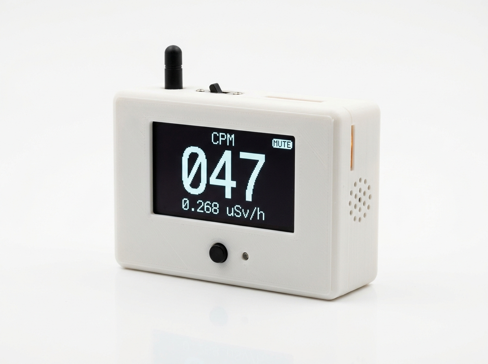
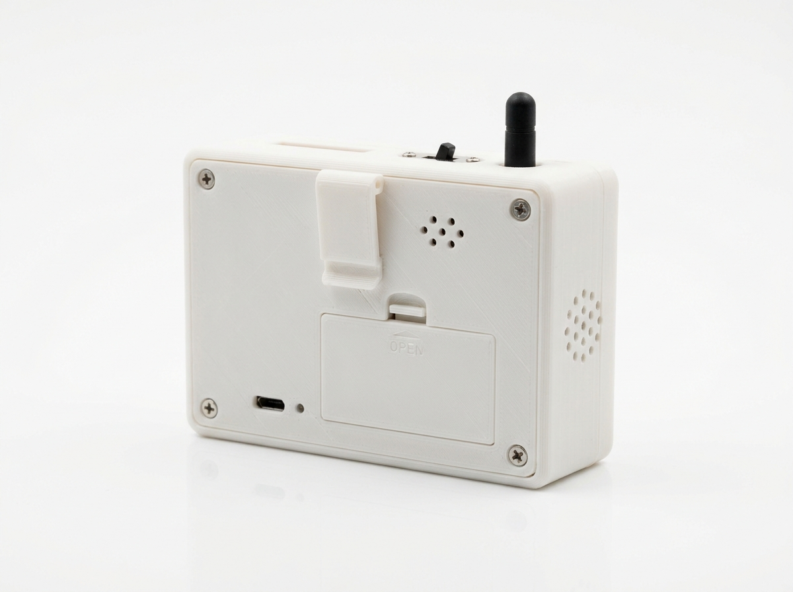

# ESP32 Geiger Counter (SBM-20)

A PlatformIO / Arduino-framework firmware for an ESP32 DevKitC (ESP32-WROOM-32)
Geiger counter built around an **SBM-20** Geiger-Müller tube and an external
400 V boost converter module.

The firmware does **not** control the high-voltage supply. It only listens for
the module's pulse output (one active-low pulse of about 100 µs per detected
event), counts the pulses, and presents the results.

> **Note on accuracy:** the CPM → µSv/h conversion factor used by this firmware
> (`SBM20_USV_PER_CPM = 0.0057`) is a **published nominal value** and has **not
> been calibrated against a reference source**. The µSv/h figures are rough
> estimates and must not be used for safety-critical decisions or as a
> substitute for a calibrated dosimeter. CPM and total counts are raw
> measurements and are not affected by this factor.

<table>
  <tr>
    <td align="center"><br>Main View</td>
    <td align="center"><br>Back View</td>
  </tr>
</table>

## Features

- Interrupt-driven pulse counting (IRAM ISR, `portMUX` critical section, no blocking code)
- CPM over a rolling 60-second window (ring buffer of 60 per-second counts)
- Dose-rate estimate in µSv/h (`SBM20_USV_PER_CPM`, default `0.0057`, uncalibrated nominal value)
- SSD1306 128x64 OLED (U8g2), three screens cycled with a button:
  1. Big CPM value + µSv/h
  2. Bar graph of the last 60 seconds (one bar per second)
  3. Total counts since boot + uptime
- Passive piezo "click" per pulse (~2 ms, 4 kHz, LEDC PWM), mute with a long press
- Status LED: short blink per pulse, solid while muted
- CSV output on the serial port at 115200 baud, once per second

## SAFETY: set the HV to 400 V BEFORE connecting the tube

The boost module produces **hundreds of volts**. Before the SBM-20 is connected:

1. Power the boost module on its own, with the tube **disconnected**.
2. Measure the output with a high-impedance, HV-rated probe or meter (not a
   standard 10 MΩ multimeter probe unless it is rated for the voltage).
3. Adjust the module's trimmer until the output is **400 V**.
4. Power down and wait for the output capacitors to discharge.
5. Only then connect the tube.

Overvoltage can permanently damage the tube or put it into continuous discharge.
Treat the HV section as dangerous: do not touch it while powered.

## Wiring

| ESP32 pin | Connected to                                  | Notes                                      |
|-----------|-----------------------------------------------|--------------------------------------------|
| GPIO 27   | Boost module pulse output                     | Falling-edge interrupt, internal pull-up   |
| GPIO 21   | OLED SDA                                      | I2C data                                   |
| GPIO 22   | OLED SCL                                      | I2C clock                                  |
| GPIO 25   | Passive piezo buzzer (+)                      | LEDC channel 0, other lead to GND          |
| GPIO 0    | Tactile button (other leg to GND)             | Active low, internal pull-up (BOOT button) |
| GPIO 2    | Onboard LED                                   | Status / pulse / mute indicator            |
| 3V3       | OLED VCC                                      |                                            |
| GND       | OLED GND, buzzer, button, boost module GND    | **Common ground is required**              |

Notes:

- The ESP32 GPIOs are **3.3 V only**. If the boost module's pulse output swings
  to 5 V, add a resistor divider or level shifter before GPIO 27.
- GPIO 0 is a boot-strapping pin. Do not hold the button while the board
  resets or powers up, or it will enter the serial bootloader. The DevKitC
  BOOT button is already wired to GPIO 0, so you can use that one.
- Some ESP32 DevKitC clones have no LED on GPIO 2. If yours doesn't, wire an
  external LED + resistor to GPIO 2.

## Build and flash

Requires [PlatformIO](https://platformio.org/) (CLI or the VS Code extension).

```bash
# Build
pio run

# Flash (board connected via USB)
pio run -t upload

# Serial monitor (115200 baud)
pio device monitor
```

The `U8g2` library is installed automatically from `platformio.ini`.

If upload fails to start, hold the BOOT button while the upload begins, then release it.

## Usage

| Action                 | Result                                         |
|------------------------|------------------------------------------------|
| Short press            | Next screen (CPM → graph → totals → CPM ...)   |
| Long press (≥ 1 s)     | Toggle mute (buzzer off, status LED solid on)  |

For the first 60 seconds after boot the CPM is extrapolated from the seconds
collected so far, and the CPM screen shows `WARMUP Ns`. The value is noisy
until the full window is filled.

## Serial output

One CSV line per second after a header line:

```
uptime_ms,cpm,usv_h,total_counts
1001,0,0.0000,0
2001,30,0.1710,1
3001,45,0.2565,2
```

## Configuration

All tunables are in the clearly marked config block at the top of `src/main.cpp`:
pins, window length, buzzer frequency and click length, LED pulse time, button
timing, display refresh rate, and the conversion factor:

```cpp
constexpr float SBM20_USV_PER_CPM = 0.0057f;
```

### About the conversion factor

The default of 0.0057 µSv/h per CPM (roughly 175 CPM per µSv/h) is a
**published nominal value** for the SBM-20 with Co-60/Cs-137 type gamma
radiation. It is **not calibrated against a reference source** for this
particular build. Real-world accuracy depends on several factors that this
factor does not account for:

- tube-to-tube variation and tube age,
- the actual operating voltage set on the boost module,
- dead-time effects at high count rates,
- the energy of the radiation being measured (the SBM-20 is not
  energy-compensated, so it over- or under-reads for isotopes other than the
  one the factor is based on),
- the tube's sensitivity to beta radiation, which is counted as well.

The reported µSv/h is therefore an estimate, not a certified dosimeter reading.
If accuracy matters, expose the counter to a known reference source (or
compare against a calibrated instrument), then adjust `SBM20_USV_PER_CPM`
accordingly and reflash.

## Design notes

- **ISR:** increments a `volatile uint32_t` inside a `portMUX` critical section
  and sends a FreeRTOS task notification. Nothing blocking happens in it.
- **Click/LED task:** a tiny task on core 0 sleeps until notified, then
  produces the 2 ms click and the LED blink. This keeps click timing accurate
  while `loop()` is busy sending the display buffer over I2C. Pulses arriving
  during a click/blink are coalesced, so audible clicks are capped at roughly
  60 per second at very high count rates (the counting itself is unaffected).
- **Timing:** `loop()` has no `delay()`; the 1-second tick, button debounce,
  long-press detection, display refresh and the on-screen toast are all
  `millis()`-based.
- **Display text:** the µ symbol is written as `u` (`uSv/h`) on screen and in
  documentation of the serial header to stay within plain ASCII.
- **Core compatibility:** `platformio.ini` pins the platform to 6.9.0
  (Arduino-ESP32 2.0.17). The LEDC calls are wrapped so the code also builds
  on Arduino-ESP32 3.x.

## Project layout

```
.
├── platformio.ini
├── README.md
├── .gitignore
└── src
    └── main.cpp
```

## Troubleshooting

- **Blank OLED:** check SDA/SCL wiring and that the address is 0x3C
  (some modules use 0x3D; change `OLED_I2C_ADDR`).
- **Always 0 CPM:** verify the tube is connected, the HV is at 400 V, the
  boost module's pulse output reaches GPIO 27, and grounds are common.
- **Very high or erratic counts:** suspect electrical noise, a loose HV
  connection, or an HV setting that is too high. Check wiring and the 400 V setting.
- **Board won't boot with the button wired:** GPIO 0 must be high during reset.